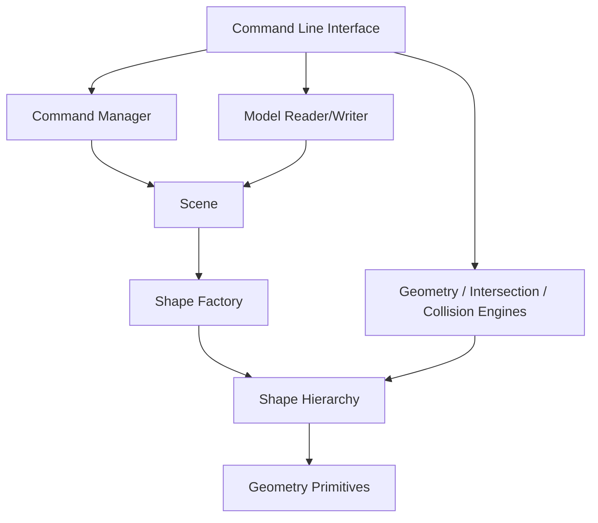

# Architecture

GeoCAD is intentionally layered so the geometry engine does not depend on the command-line interface.

## Layers

### Geometry layer
Contains points, vectors, matrices, lines and bounding boxes. These classes have no knowledge of scenes or user commands.

### Shape layer
Defines the polymorphic `Shape` abstraction and concrete 2D/3D shapes.

### Engine layer
Contains reusable computational logic. This prevents mathematical algorithms from being duplicated in shape classes or the CLI.

### Scene layer
Owns shape objects using `std::unique_ptr` and uses an `unordered_map` for average O(1) ID lookup.

### Command layer
Implements reversible application operations. `CommandManager` owns undo and redo stacks.

### IO layer
Encodes and reconstructs a scene using a readable line-oriented `.geocad` format.

### CLI layer
Translates human commands into calls into the domain/application layers. It is intentionally kept thin.
