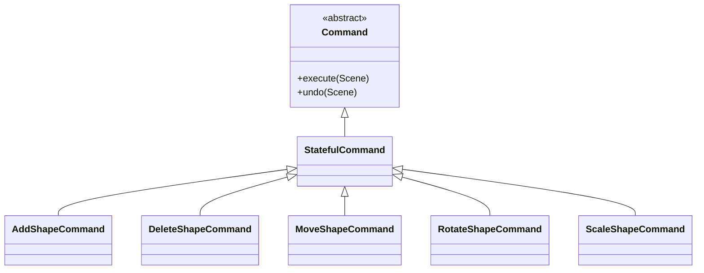

# Design Patterns

## Command Pattern

Used by shape modification commands and `CommandManager`.

In this implementation, the first execution records a before/after scene snapshot. Redo restores the recorded after state, and undo restores the before state. This favors correctness and clarity for a teaching project.

## Factory Pattern

`ShapeFactory` centralizes construction from a textual representation. This means the CLI and loader do not need to know each constructor's validation rules.

## Strategy-style extension point

Collision logic is selected by shape type inside `CollisionDetector`. The current code keeps the implementation compact; a production-scale version could promote collision strategies into separate classes implementing a common interface.

The project deliberately avoids adding patterns that do not solve a real problem.
